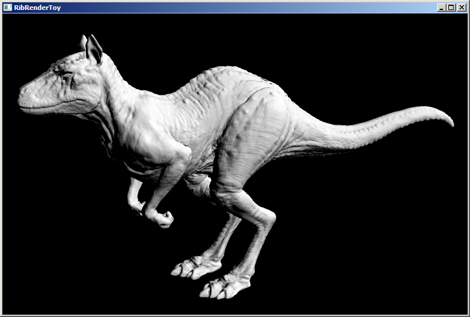
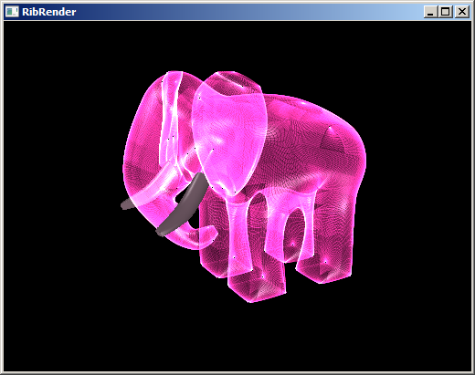
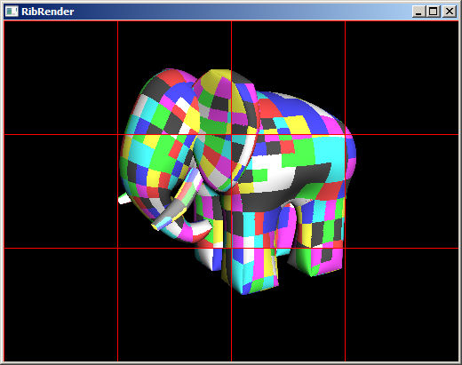

RibTools
========

**RibTools** is an experiment in writing an off-line renderer based on Pixar's [RenderMan interface] and the [REYES] rendering architecture.

> **2026 maintenance:** New and substantially edited C++ uses four spaces rather than tabs and follows
> [Davide Pasca's current C++ style guide]. This is a forward-looking policy; legacy files are not being mass-formatted.
> See [CONTRIBUTING.md] for the practical rules.

> **Historical notice:** Major development was suspended in 2010. The project received occasional maintenance through
> 2020, followed by a basic build and tooling refresh in 2026.

[RenderMan interface]: http://en.wikipedia.org/wiki/RenderMan_Interface_Specification
[REYES]: http://en.wikipedia.org/wiki/Reyes_rendering
[Davide Pasca's current C++ style guide]: https://gist.githubusercontent.com/dpasca/5243278/raw/c92097874494f1735e033e1937506701f747dc4d/CodeStyle.cpp
[CONTRIBUTING.md]: CONTRIBUTING.md

At the core of **RibTools** there is **RibRender**, the rendering engine, built with speed and scalability in mind.

Parallelism is implemented at all levels:
* Instruction level (adaptive N-way SIMD)
* Many-core hardware (multi-threading)
* Network-distributed rendering (custom protocol over TCP/IP)

**RibTools** is a rather crude experiment and it's only tested against a small selection of simple scenes included in the project.





Building and running
--------------------

### Requirements

- CMake 3.21 or newer
- A C++20 compiler
- The platform OpenGL and GLU development files
- X11 and XInput development files on Linux

Initialize the pinned dependencies after cloning. libjpeg-turbo 3.2.0 and libtiff 4.7.2 provide image codecs.
FreeGLUT is used on Windows and Linux; macOS uses the system GLUT framework.

```sh
git submodule update --init --recursive
```

### macOS and Linux

The compatibility scripts keep build products in `_build` and stage runnable files in `_distrib`:

```sh
./make_build.sh Release
./do_build.sh Release
ctest --test-dir _build --output-on-failure
```

The equivalent preset workflow is:

```sh
cmake --preset release
bash ./make_distrib.sh
cmake --build --preset release
ctest --preset release
```

### Windows

Run `make_build.bat`, followed by `do_build.bat`. Visual Studio users can also open `_build\RibTools.sln` and select the
Release configuration.

### Run the renderer toy

Launch `RibRenderToy` from `_distrib` (`RibRenderToy.exe` on Windows), then right-click in its window to choose one of the
included test scenes. The OpenGL/GLUT front end is intentionally still the original compatibility implementation.

About
-----

**RibTools** was developed by Davide Pasca in 2009-2010. Development is currently suspended.

This software is released under the [New BSD license](http://www.opensource.org/licenses/bsd-license.php) .

The following software libraries are utilized in the project:

* libjpeg-turbo: https://github.com/libjpeg-turbo/libjpeg-turbo
* LibTIFF: https://libtiff.gitlab.io/libtiff/
* FreeGLUT: https://github.com/dcnieho/FreeGLUT

Other acknowledgements:

* The *Killeroo* model is Copyright of Headus, used with
permission: http://www.headus.com.au

* The *Sponza Atrium*  model is originally from Marko Dabrovic: http://hdri.cgtechniques.com/~sponza/files/ \
The RIB version was taken from the *Lucille* renderer
 distribution and modified as needed: http://lucille.sourceforge.net/

* Most of the included RIB files are old samples that I found included in the *RenSH*
 project: http://www.dctsystems.co.uk/RenderMan/rensh.html

* Other sample scene files were found on the Internet and are assumed to be freely
redistributable.

For any issues regarding attribution, please contact me at `davide@newtypekk.com`.

The *RenderMan&reg; Interface Procedures* and RIB Protocol are: Copyright 1988, 1989,
Pixar. All rights reserved. *RenderMan&reg;* is a registered trademark of Pixar.
