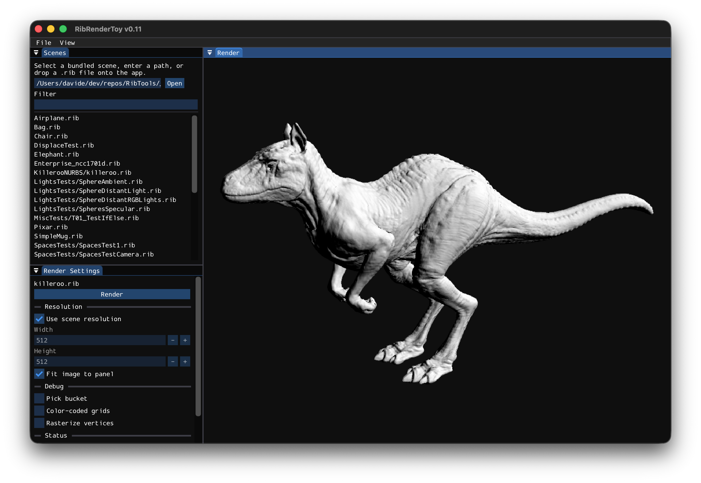

# RibTools

RibTools is an experimental offline renderer based on Pixar's
[RenderMan interface](https://en.wikipedia.org/wiki/RenderMan_Interface_Specification)
and the [REYES](https://en.wikipedia.org/wiki/Reyes_rendering) rendering architecture.



*RibRenderToy rendering the displaced Killeroo NURBS model in its default docked workspace.*

## Project status

The renderer core was developed mainly during 2009 and 2010. It received occasional maintenance through 2020, followed
by a build, dependency, testing, and desktop interface refresh in 2026. The current work aims to make the historical code
easier to build, test, and explore while preserving the original renderer architecture.

RibTools remains an experimental project rather than a production RenderMan implementation. It is tested against the
bundled scenes and intentionally supports only part of the RenderMan interface.

## Highlights

- RIB scene parsing and a REYES-style micropolygon renderer.
- NURBS geometry, surface shaders, texture-driven displacement, lighting, and image output.
- Multithreaded rendering, adaptive SIMD code, and an experimental TCP/IP distributed rendering path.
- A RenderMan-like Shading Language compiler that produces the custom `.rrasm` format used by the shader virtual machine.
- Interactive scene selection, file dropping, render controls, and debug views for buckets, grids, and vertices.
- A Dear ImGui workspace that starts with the rendered image docked inside the main window and can optionally use native
  external viewports.

## Applications

| Application | Purpose |
| --- | --- |
| `RibRenderToy` | The primary interactive viewer for bundled or user-supplied RIB scenes. |
| `RibRender` | The command-line render driver, including optional network render servers and framebuffer windows. |
| `RSLCompilerCmd` | A standalone testing frontend that compiles RenderMan-like `.sl` source to `.rrasm`. |
| `RibRenderServer` | Runs an experimental render worker that accepts connections from `RibRender`. |

## Building

### Requirements

- Git, including submodule support.
- CMake 3.21 or newer.
- A C++20 compiler.
- OpenGL development files.
- X11 development files when building on Linux.

All third-party dependencies are pinned as Git submodules. They include libjpeg-turbo, LibTIFF, Dear ImGui's docking
branch, and GLFW.

If the repository was cloned without submodules, initialize them first:

```sh
git submodule update --init --recursive
```

### Quick start on macOS and Linux

The compatibility scripts create `_build`, stage runtime resources in `_distrib`, build the project, and run the test
suite:

```sh
./make_build.sh Release
./do_build.sh Release
ctest --test-dir _build --output-on-failure

cd _distrib
./RibRenderToy TestScenes/KillerooNURBS/killeroo.rib
```

The equivalent CMake preset workflow is:

```sh
cmake --preset release
bash ./make_distrib.sh
cmake --build --preset release --parallel
ctest --preset release
```

On Ubuntu, the packages used by CI are:

```sh
sudo apt-get install \
    libgl1-mesa-dev \
    libx11-dev \
    libxcursor-dev \
    libxext-dev \
    libxi-dev \
    libxinerama-dev \
    libxrandr-dev \
    xauth \
    xvfb
```

### Windows

Run `make_build.bat`, followed by `do_build.bat`. Visual Studio users can also open `_build\RibTools.sln`, select the
Release configuration, and launch the executables from `_distrib`. The Windows build path is retained, but it has not yet
received fresh validation as part of the 2026 refresh.

## Using RibRenderToy

Start without arguments to browse the bundled scenes:

```sh
cd _distrib
./RibRenderToy
```

You can select a scene in the **Scenes** panel, enter a path, or drop a `.rib` file onto the application. The **Render
Settings** panel controls resolution and the existing bucket, grid, and vertex debug modes.

The default layout keeps the **Render** panel docked inside the main window. To use a separate native window, drag the
**Render** tab outside the main window, choose **View > Detach Render Window**, or launch with:

```sh
./RibRenderToy --detach-render TestScenes/KillerooNURBS/killeroo.rib
```

The layout is saved in `_distrib/rib-render-toy.ini`. Choose **View > Reset Docking Layout** to restore the default.
External viewports work on macOS and Windows. On Linux they require X11 and remain window-manager dependent. They are
disabled on Wayland because Dear ImGui's GLFW backend does not currently support multi-viewports there.

## Command-line rendering

Render a RIB file directly:

```sh
cd _distrib
./RibRender TestScenes/Airplane.rib
```

Use `--help` with any executable to see its available options. `RibRender` can also constrain the longest image dimension,
show grids in false colors, or connect to one or more `RibRenderServer` instances.

## Platform status

| Platform | Current status |
| --- | --- |
| macOS 15 on Apple Silicon | Built and tested locally and in CI. |
| Ubuntu 24.04 | Built and tested in CI, including a UI smoke test under Xvfb. |
| Windows | CMake and Visual Studio support retained. Fresh validation is still pending. |

The test suite covers core utility and image behavior, shader compilation, invalid shader rejection, executable startup,
and the Linux UI smoke path. Rendered-image regression coverage is a priority for the next maintenance stage.

## Current limitations

- The RenderMan interface and RIB command set are incomplete.
- Rendering behavior is validated primarily with the scenes bundled in the repository.
- The desktop renderer retains a compatibility OpenGL path to support the original fixed-function display code.
- Distributed rendering is experimental and is not covered by the current CI suite.
- There are no packaged binary releases for the refreshed version yet.

## Near-term direction

1. Add representative rendered-image regression tests, beginning with lighting, displacement, and Killeroo.
2. Polish the desktop interface and improve scene and shader error reporting.
3. Revalidate and repair the Windows build.
4. Modernize renderer internals incrementally, with focused changes and regression coverage.
5. Prepare a first maintenance release once the refreshed branch is stable on all supported platforms.

## History and acknowledgements

RibTools was created by Davide Pasca. The Killeroo model is copyright Headus and is used with permission from
[Headus](http://www.headus.com.au).

The Sponza Atrium model is originally by Marko Dabrovic. The RIB version came from the
[Lucille renderer](http://lucille.sourceforge.net/) and was modified as needed.

Most included RIB files are historical samples found in the
[RenSH project](http://www.dctsystems.co.uk/RenderMan/rensh.html). Other sample scene files were found on the Internet and
are assumed to be freely redistributable. For attribution concerns, contact `davide@newtypekk.com`.

The RenderMan Interface Procedures and RIB Protocol are copyright 1988 and 1989 Pixar. RenderMan is a registered trademark
of Pixar.

## Dependencies

- [libjpeg-turbo](https://github.com/libjpeg-turbo/libjpeg-turbo)
- [LibTIFF](https://libtiff.gitlab.io/libtiff/)
- [Dear ImGui](https://github.com/ocornut/imgui)
- [GLFW](https://github.com/glfw/glfw)

## License

RibTools is released under the [3-Clause BSD License](license.txt).
